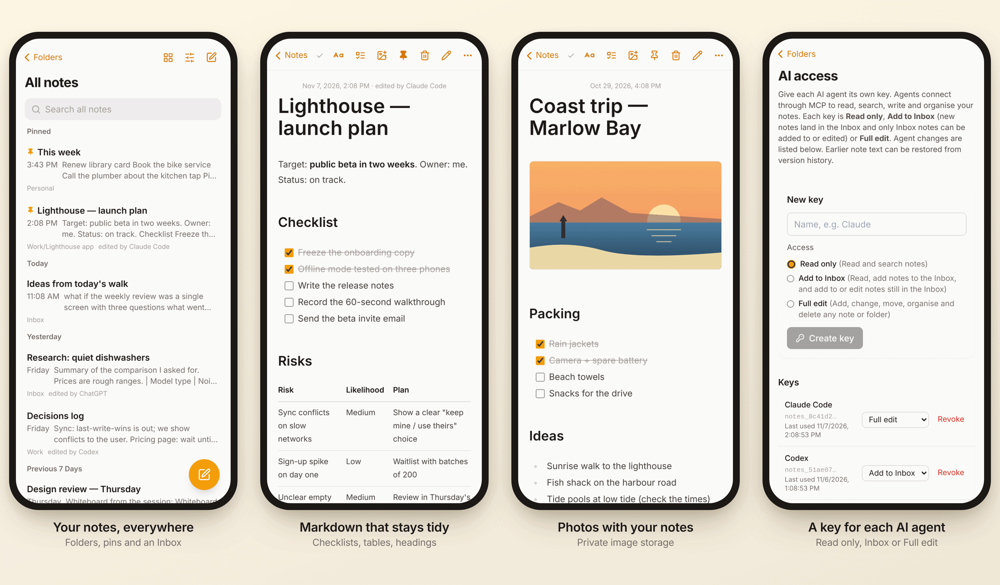
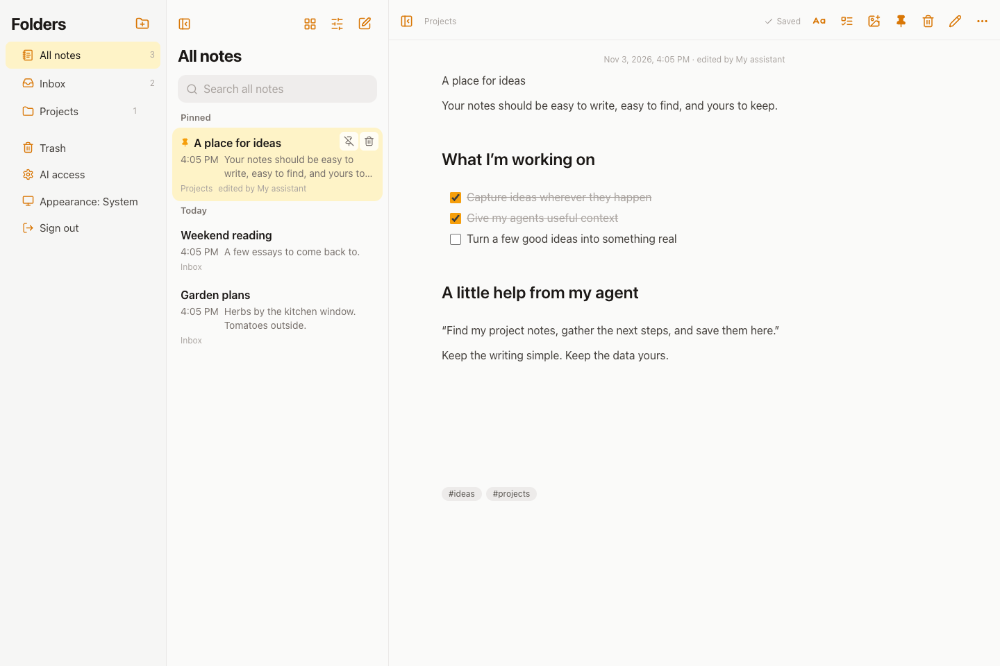
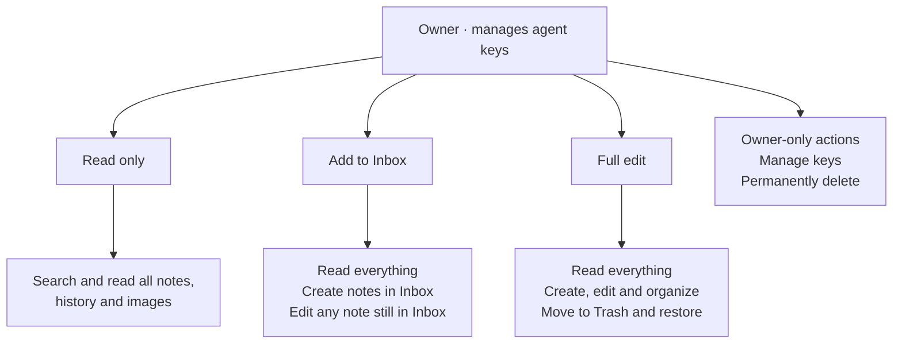
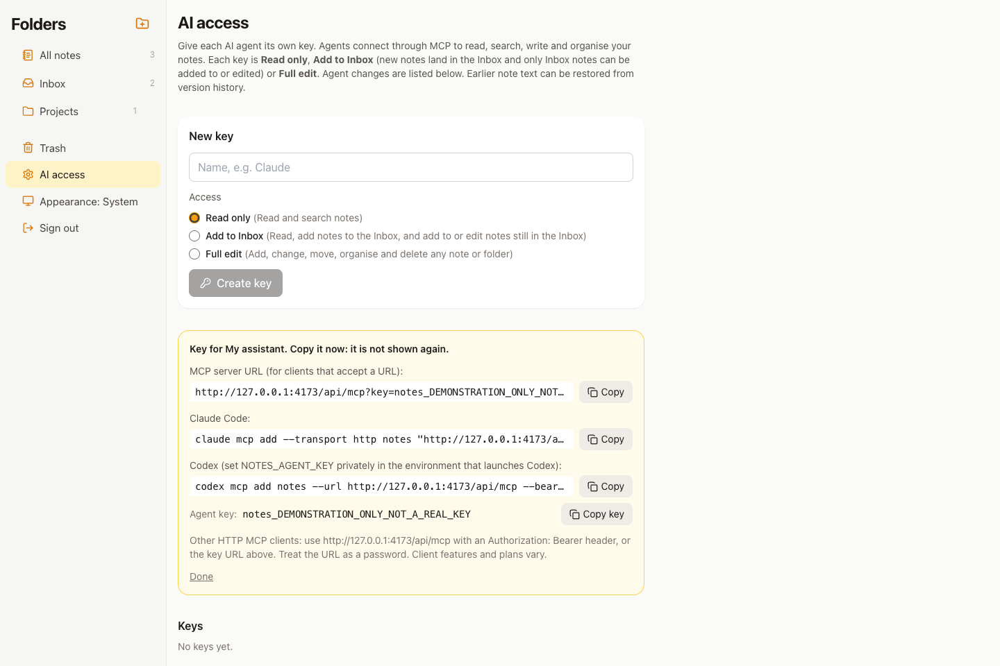
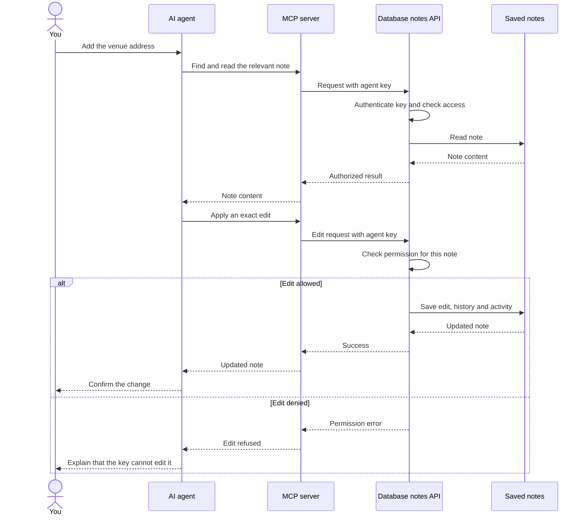
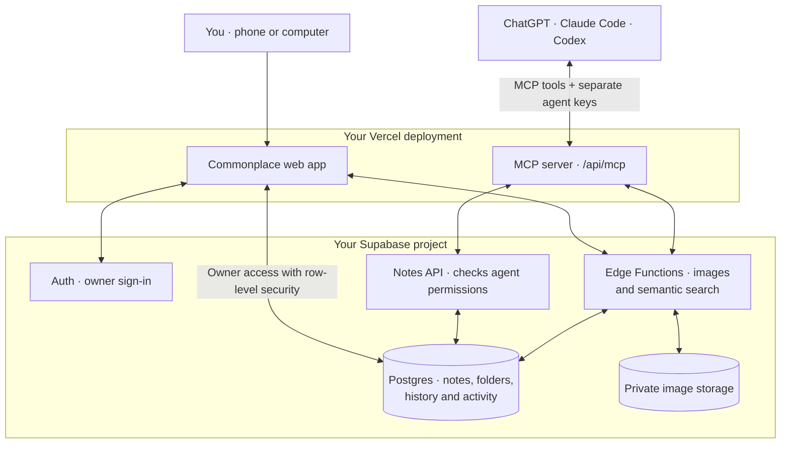

<p align="center">
  
</p>

<h1 align="center">Commonplace</h1>

<p align="center">
  <strong>The notes app your AI agents share. Open source, self-hosted, and yours.</strong>
</p>

<p align="center">
  <a href="INSTALL.md">Install</a> ·
  <a href="docs/agents.md">Connect your agents</a> ·
  <a href="docs/data.md">Export &amp; backup</a> ·
  <a href="SECURITY.md">Security model</a> ·
  <a href="LICENSE">MIT license</a>
</p>

Commonplace is a clean, Apple Notes–style notes app with a built-in [Model Context Protocol](https://modelcontextprotocol.io/) (MCP) server. You write on your phone or computer. ChatGPT, Claude Code, Codex and other MCP clients can search, read, add to, and organize the same notes, using only the permissions you give each one.

It's named after the *commonplace book*, the notebook people have kept for centuries to collect ideas, quotes, and plans to reuse later. In this one, your AI agents can use those notes too.



*Screens from the [demo](#try-the-demo), with fictional sample notes.*

## Why Commonplace?

AI note apps usually charge a monthly subscription, keep your notes on their servers, and tie you to their built-in assistant. Commonplace takes a different approach:

- **Bring the AI you already use.** Connect ChatGPT, Claude Code, Codex, or any remote-MCP client. Switch agents whenever you like without moving your notes.
- **One shared memory for all of them.** Save research in one agent and pick it up in another, without copying and pasting or explaining it again.
- **Your data, your accounts.** It deploys into *your own* Supabase and Vercel accounts, and your notes are plain Markdown in your own Postgres database. There's no upstream service and no telemetry.
- **No AI API key or subscription needed.** Semantic search uses Supabase's built-in embedding model. The app targets the providers' free personal tiers ([details](#hosting-on-free-tiers)).
- **You decide what each agent can do.** Give each agent its own key with Read only, Add to Inbox, or Full edit access. The database enforces these limits, agent changes are logged with version history, and you can revoke a key at any time.
- **A good notes app first.** Folders, pins, checklists, tables, images, version history, Trash, offline drafts, and dark mode. You can use it every day even without AI.

## Try the demo

Demo mode runs the real app in your browser with fictional sample notes. It needs no backend and no account. Nothing is saved: a reload (or **Sign out**) starts over. Everything works except the parts that need a server, such as image uploads and creating agent keys, which say so when you try them. Agents can't connect to the demo.

<!-- Add the link to your hosted demo here, e.g. **[Open the live demo →](https://your-demo.vercel.app)** -->

Run it locally:

```sh
npm ci
npm run dev:demo
```

### Host your own demo

1. Import this repository as a **new** Vercel project (framework **Vite**, build command `npm run build`, output `dist`).
2. Add the environment variable `VITE_DEMO` = `true`. Leave out the Supabase variables; the demo doesn't use them.
3. Deploy. You don't need a Supabase project, database or other backend.

Any static host works as well: run `npm run build:demo` and publish the `dist` folder.

## Demo videos

[](https://github.com/farhan1301/notes-with-mcp/releases/tag/demo-videos)

**[60-second overview (MP4)](https://github.com/farhan1301/notes-with-mcp/releases/download/demo-videos/notes-with-mcp-60s.mp4)** · **[2-minute walkthrough (MP4)](https://github.com/farhan1301/notes-with-mcp/releases/download/demo-videos/notes-with-mcp-walkthrough-120s.mp4)**

## Get started in one prompt

Give Codex, Claude Code, or another coding agent this prompt:

> Install https://github.com/farhan1301/notes-with-mcp for me. Read INSTALL.md and follow it to set up a private, single-owner Commonplace instance in my own Supabase and Vercel accounts using the free personal-use tiers. Handle the setup and verification you can, and guide me through account sign-in or steps that need my input. Do not purchase anything or modify an existing project.

Prefer to do it yourself? Follow the **[installation guide](INSTALL.md)**. It also works as a runbook for coding agents.

You'll need a Supabase account and a Vercel account. You (not the agent) handle signing in, choosing the owner account, and approving credentials. Commonplace doesn't need a paid AI API key; any subscription for the agents you connect is separate.

## Everyday notes features

- **Familiar layout:** resizable folders, notes, and editor columns; list or gallery view; pins; date grouping; light, dark, or system appearance.
- **Write naturally:** plain text or Markdown, formatting controls, headings, lists, checklists, tables, and autosave. If your connection drops, drafts stay on the device and sync when you reconnect.
- **Keep images with your notes:** paste, drag, or upload photos and screenshots to private storage. Agents can view supported images and add new ones as base64. Downloading images from URLs is an optional setting the administrator turns on.
- **Find things:** keyword search, tags, and optional semantic (meaning-based) search.
- **Recover changes:** note version history, conflict detection, a Trash for notes, and a 30-day Trash for images.
- **Use it on your phone:** add the web app to your home screen. It's a web app (PWA), not a native iOS client.



*On a computer: folders, notes, and the editor side by side (fictional notes).*

## Connect your AI agents

Your notes can be a **context layer you own**, shared across the AI agents you use. Keep ideas, plans, decisions, reference material, and images in one place. Each connected agent can find and work with those notes using the access you give it.

### 1. Create a key for each agent

Open **AI access** in Commonplace, give the key a name such as “ChatGPT”, “Claude Code”, or “Codex”, and choose its permissions. Create separate keys so you can change or revoke one agent's access independently.

| Key access | What the agent can do |
| --- | --- |
| Read only | Read and search every note, including history and images. |
| Add to Inbox | Read everything; create Inbox notes and edit or add images to notes still in the Inbox. |
| Full edit | Create, edit, tag, pin, move, trash, restore, and organize notes and folders. |

Agent changes appear in the activity log. Change permissions or revoke a key at any time. **Add to Inbox is not an append-only or folder-private key:** it can read all notes and edit all Inbox notes. Full edit is the broadest agent level; permanent deletion and key management remain owner actions in the app.



### 2. Add your notes as a custom MCP connection

AI access shows the connection URL and setup commands when you create a key. Copy them into your agent's custom MCP or plugin settings.

| Agent | How to connect |
| --- | --- |
| **ChatGPT** | On the web, open **[Plugins](https://chatgpt.com/plugins)** → **+** → **Add custom MCP server**. Name it “Commonplace”, paste the key URL from AI access as the Server URL, and select **Create as a plugin**. Install the plugin, then select it with `@` in your conversation. |
| **Claude Code** | Add the connection with `claude mcp add --transport http notes "YOUR_MCP_KEY_URL"`. AI access provides the command with your own URL. |
| **Codex** | Use the command in AI access to add the MCP endpoint, with your key supplied through the private `NOTES_AGENT_KEY` environment variable. |
| **Other MCP-capable agents** | Add a custom remote MCP server using your endpoint and an Authorization bearer key, or the key URL if the client accepts URL-based connections. |

For ChatGPT's key-URL connection, choose **No authentication** if the creation screen asks for an authentication method: the key included in the URL authenticates requests to your Commonplace instance. Keep that URL private, just like a password. Custom plugin access depends on your account and workspace permissions. See the [official ChatGPT setup guide](https://developers.openai.com/api/docs/guides/custom-mcp-server) and our [detailed agent connection guide](docs/agents.md).



*Example connection screen with a fictional key.*

### 3. Use the same context across agents

Save research with ChatGPT, ask Claude Code to use those notes while building a project, and ask Codex to record the resulting decisions. The next agent can pick up from the notes already saved, with less repeated explanation and copy-pasting.

You choose what to save and which agents can change it. Your notes stay in your database as you switch agents, and the app remains a place where you can read and edit them yourself. Agents retrieve relevant notes on demand through MCP; saved notes and supported images form the shared context, while each agent's conversation history stays with that agent.

Examples:

> “Save this conversation's decisions to my Inbox.”
>
> “Find my notes about the garden and summarize the open questions.”
>
> “Organize my Inbox into the folders I already use. Preserve my wording.”
>
> “Add this screenshot to my project note.”

The server offers 23 tools over stateless Streamable HTTP with bearer-key authentication. Use a client that supports remote HTTP MCP and either bearer headers or a key URL. See [the connection guide](docs/agents.md) for configuration, supported operations, and a quick connection check.

### What happens when an agent edits a note

For example: “Add the venue address to my wedding note.” The agent reads the note, then requests a targeted edit. The database checks the key before allowing the change.



Permissions are enforced in the database, even if an agent lists tools its key cannot use. For small changes, prefer exact edits or appends; for rewrites, read the note first and supply its expected version. See the [agent connection guide](docs/agents.md).

## How it works

You and your agents work with the same saved notes through two access paths. You sign in to the web app; agents use MCP with separate permission keys. Each agent retrieves context when needed, while conversation histories stay with their respective agents.



One owner per installation, identified by their Supabase Auth UUID. Row Level Security blocks other accounts. Agent keys are stored as hashes. The web app and Vercel MCP endpoint use only your Supabase publishable key. The Supabase Edge Functions use server-side credentials to manage images and embeddings.

Notes are Markdown text in Postgres, with an [export command](docs/data.md). You control the database, storage, backups, and deployment. This is **not end-to-end encryption**: the hosting providers and agents you authorize can process your data. [Security model →](SECURITY.md)

## Hosting on free tiers

Designed for a personal installation on **Supabase Free + Vercel Hobby**. As checked November 3, 2026:

- Supabase Free includes a 500 MB database and 1 GB file storage, with usage quotas; projects can pause after a week of inactivity. [Provider pricing](https://supabase.com/pricing).
- Vercel Hobby is for personal, non-commercial use and has usage limits. Commercial use needs an eligible plan. [Hobby terms and limits](https://vercel.com/docs/plans/hobby).
- Semantic search uses built-in `gte-small`, with no external model API key. Embeddings, images, and agent calls still consume provider resources. Large image collections or frequent agent activity can exceed free quotas.

Free hosting is subject to provider terms and changes. No paid plan is required by the installation guide. Back up your notes independently.

## Develop and contribute

Node 22.14+ (Node 24 LTS recommended) and npm:

```sh
npm ci
npm test
npm run build
```

For a configured development workspace, copy `.env.example` to `.env.local`, supply your own public project values, and run `npm run dev`. Vite serves the UI only; use `vercel dev` for `/api/mcp`. Never point automated tests at your live database. `npm run dev:demo` runs the UI on an in-memory sample backend (`src/demo/`). If you add a new query or table, add it to the demo client and seed too. See [CONTRIBUTING.md](CONTRIBUTING.md) for database, Edge Function, and MCP integration checks, and [docs/verification.md](docs/verification.md) for what was checked before release.

Built with React, Vite, Tailwind, Supabase, and Vercel. Inspired by the simplicity of Apple Notes; not affiliated with Apple.

## License

[MIT](LICENSE). Issues and pull requests are welcome. Please read [CONTRIBUTING.md](CONTRIBUTING.md) first and report security problems privately as described in [SECURITY.md](SECURITY.md).
